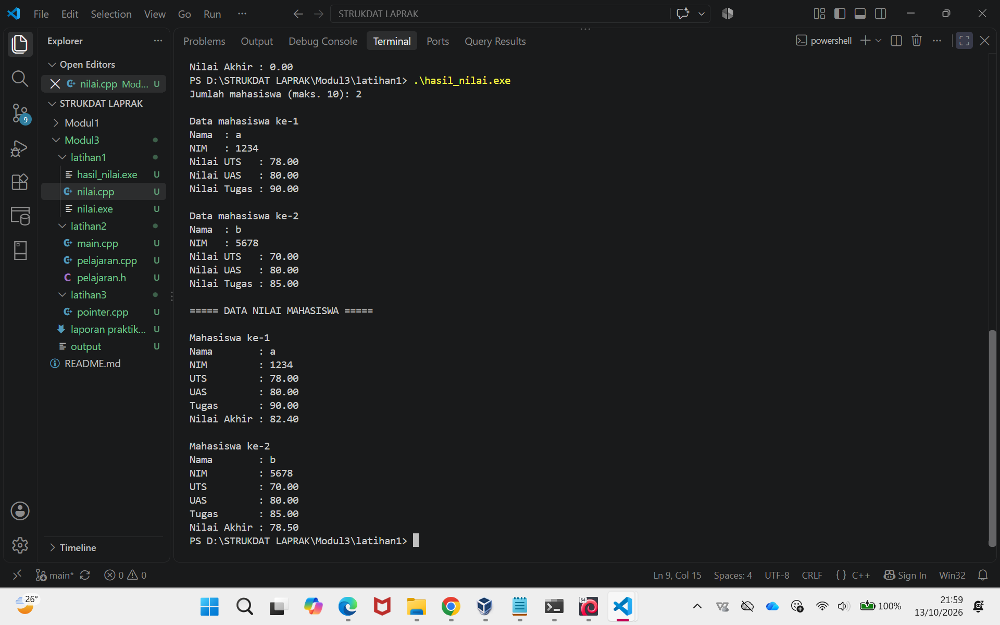
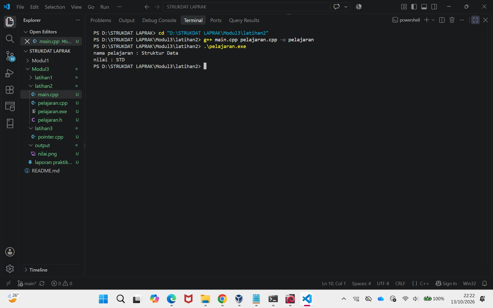
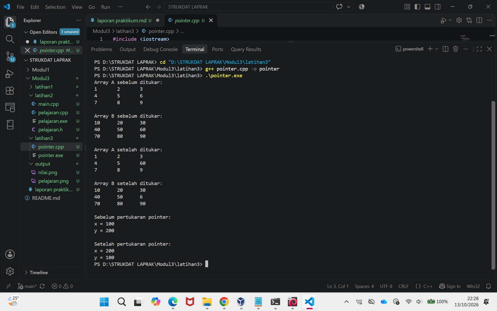

# <h1 align="center">Laporan Praktikum Modul 3 - ABSTRACT DATA TYPE (ADT) </h1>

<p align="center">Nafisah Salsabila - 109082500063</p>

## Dasar Teori

### A. Abstract Data Type<br/>

#### 1. Pengertian
Abstract Data Type (ADT) adalah model data yang mendefinisikan data dan operasi yang dapat dilakukan terhadap data tersebut, tanpa menjelaskan bagaimana implementasinya secara detail.

#### 2. Contoh
Stack — menggunakan prinsip LIFO (Last In, First Out).
Queue — menggunakan prinsip FIFO (First In, First Out).
List — menyimpan sekumpulan elemen yang memiliki urutan tertentu.

### B. Algoritma<br/>
Algoritma adalah langkah-langkah logis dan sistematis yang digunakan untuk menyelesaikan suatu masalah.
Dalam praktikum, algoritma dapat dituliskan dalam bentuk pseudocode sebelum diimplementasikan ke dalam bahasa pemrograman.

#### C. Pseudocode
Pseudocode adalah penulisan langkah-langkah algoritma menggunakan bahasa yang sederhana dan terstruktur sehingga mudah dipahami sebelum diterjemahkan menjadi kode program.

#### D. Percabangan
 Percabangan digunakan untuk menentukan instruksi yang dijalankan berdasarkan suatu kondisi. Dalam C++, percabangan dapat menggunakan if, else if, dan else.

#### E. Input/Output
C++ menggunakan cin untuk menerima input dari pengguna dan cout untuk menampilkan output ke layar.


## Guided

### 1. ...

```C++
source code guided 1
```

penjelasan singkat guided 1

### 2. ...

```C++
source code guided 2
```

penjelasan singkat guided 2

### 3. ...

```C++
source code guided 3
```

penjelasan singkat guided 3

## Unguided

### 1. Buat program yang dapat menyimpan data mahasiswa (max. 10) ke dalam sebuah array dengan field nama, nim, uts, uas, tugas, dan nilai akhir. Nilai akhir diperoleh dari FUNGSI dengan rumus 0.3 *uts+0.4* uas+0.3*tugas.

```cpp
source code unguided 1
#include <iostream>
#include <string>
#include <iomanip>
using namespace std;

struct Mahasiswa {
    string nama;
    string nim;
    float uts;
    float uas;
    float tugas;
    float nilaiAkhir;
};

float hitungNilaiAkhir(float uts, float uas, float tugas) {
    return 0.3 * uts + 0.4 * uas + 0.3 * tugas;
}

int main() {
    Mahasiswa mhs[10];
    int n;

    cout << "Jumlah mahasiswa (maks. 10): ";
    cin >> n;

    if (n < 1 || n > 10) {
        cout << "Jumlah mahasiswa tidak valid!" << endl;
        return 0;
    }

    for (int i = 0; i < n; i++) {
        cout << "\nData mahasiswa ke-" << i + 1 << endl;

        cout << "Nama  : ";
        getline(cin >> ws, mhs[i].nama);

        cout << "NIM   : ";
        cin >> mhs[i].nim;

        cout << "Nilai UTS   : ";
        cin >> mhs[i].uts;

        cout << "Nilai UAS   : ";
        cin >> mhs[i].uas;

        cout << "Nilai Tugas : ";
        cin >> mhs[i].tugas;

        mhs[i].nilaiAkhir = hitungNilaiAkhir(
            mhs[i].uts,
            mhs[i].uas,
            mhs[i].tugas
        );
    }

    cout << "\n===== DATA NILAI MAHASISWA =====" << endl;
    cout << fixed << setprecision(2);

    for (int i = 0; i < n; i++) {
        cout << "\nMahasiswa ke-" << i + 1 << endl;
        cout << "Nama        : " << mhs[i].nama << endl;
        cout << "NIM         : " << mhs[i].nim << endl;
        cout << "UTS         : " << mhs[i].uts << endl;
        cout << "UAS         : " << mhs[i].uas << endl;
        cout << "Tugas       : " << mhs[i].tugas << endl;
        cout << "Nilai Akhir : " << mhs[i].nilaiAkhir << endl;
    }

    return 0;
}
```

### Output Unguided 1 :



penjelasan unguided 1 :
Program ini digunakan untuk menyimpan dan mengolah data mahasiswa menggunakan struct dan array. Data yang disimpan meliputi nama, NIM, nilai UTS, UAS, tugas, dan nilai akhir. Program menggunakan fungsi untuk menghitung nilai akhir berdasarkan rumus 0.3 × UTS + 0.4 × UAS + 0.3 × tugas. Perulangan digunakan untuk memasukkan dan menampilkan data mahasiswa, dengan kapasitas maksimal 10 mahasiswa.

### 2. Buatlah ADT pelajaran sebagai berikut di dalam file “pelajaran.h”:

### pelajaran.h
```cpp
source code unguided 2

#ifndef PELAJARAN_H
#define PELAJARAN_H

#include <string>
using namespace std;

struct pelajaran {
    string namaMapel;
    string kodeMapel;
};

pelajaran create_pelajaran(string namapel, string kodepel);

void tampil_pelajaran(pelajaran pel);

#endif
```

### pelajaran.cpp
```cpp
source code unguided 2

#include <iostream>
#include "pelajaran.h"
using namespace std;

pelajaran create_pelajaran(string namapel, string kodepel) {
    pelajaran pel;

    pel.namaMapel = namapel;
    pel.kodeMapel = kodepel;

    return pel;
}

void tampil_pelajaran(pelajaran pel) {
    cout << "nama pelajaran : " << pel.namaMapel << endl;
    cout << "nilai : " << pel.kodeMapel << endl;
}
```

### main.cpp
```cpp
source code unguided 2

#include <iostream>
#include "pelajaran.h"
using namespace std;

int main() {
    string namapel = "Struktur Data";
    string kodepel = "STD";

    pelajaran pel = create_pelajaran(namapel, kodepel);

    tampil_pelajaran(pel);

    return 0;
}
```

### Output Unguided 2 :



penjelasan unguided 2 :
Program ini menerapkan konsep Abstract Data Type (ADT) untuk mengelola data pelajaran. Data pelajaran terdiri dari nama mata pelajaran dan kode mata pelajaran yang disimpan dalam sebuah struct. Program dibagi menjadi tiga file, yaitu pelajaran.h sebagai deklarasi tipe data dan fungsi, pelajaran.cpp sebagai implementasi fungsi, serta main.cpp sebagai program utama. Fungsi yang dibuat digunakan untuk membentuk objek pelajaran dan menampilkan informasi pelajaran tersebut.

### 3. Buatlah program dengan ketentuan : 2 buah array 2D integer, berukuran 3x3 dan 2 buah pointer integer, fungsi/prosedur yang menampilkan isi sebuah array integer 2D, fungsi/prosedur yang akan menukarkan isi dari 2 array integer 2D pada posisi tertentu, dan fungsi/prosedur yang akan menukarkan isi dari variabel yang ditunjuk oleh 2 buah pointer

```cpp
source code unguided 3
#include <iostream>
using namespace std;

const int N = 3;

void tampilArray(int A[N][N]) {
    for (int i = 0; i < N; i++) {
        for (int j = 0; j < N; j++) {
            cout << A[i][j] << "\t";
        }
        cout << endl;
    }
}

void tukarArray(int A[N][N], int B[N][N],
                int baris, int kolom) {
    int temp = A[baris][kolom];
    A[baris][kolom] = B[baris][kolom];
    B[baris][kolom] = temp;
}

void tukarPointer(int *p1, int *p2) {
    int temp = *p1;
    *p1 = *p2;
    *p2 = temp;
}

int main() {
    int A[N][N] = {
        {1, 2, 3},
        {4, 5, 6},
        {7, 8, 9}
    };

    int B[N][N] = {
        {10, 20, 30},
        {40, 50, 60},
        {70, 80, 90}
    };

    int x = 100;
    int y = 200;

    int *p1 = &x;
    int *p2 = &y;

    cout << "Array A sebelum ditukar:" << endl;
    tampilArray(A);

    cout << "\nArray B sebelum ditukar:" << endl;
    tampilArray(B);

    tukarArray(A, B, 1, 2);

    cout << "\nArray A setelah ditukar:" << endl;
    tampilArray(A);

    cout << "\nArray B setelah ditukar:" << endl;
    tampilArray(B);

    cout << "\nSebelum pertukaran pointer:" << endl;
    cout << "x = " << *p1 << endl;
    cout << "y = " << *p2 << endl;

    tukarPointer(p1, p2);

    cout << "\nSetelah pertukaran pointer:" << endl;
    cout << "x = " << *p1 << endl;
    cout << "y = " << *p2 << endl;

    return 0;
}
 
```

### Output Unguided 3 :



penjelasan unguided 3 :
Program ini digunakan untuk mengolah dua buah array integer dua dimensi berukuran 3×3 serta menerapkan konsep pointer. Program memiliki prosedur untuk menampilkan isi array dan menukar elemen pada posisi tertentu dari kedua array. Selain itu, program menggunakan dua pointer integer untuk menunjuk variabel dan menukar nilai yang ditunjuk oleh kedua pointer tersebut. Dengan demikian, program ini membantu memahami penggunaan array dua dimensi, prosedur, dan pointer dalam bahasa C++.

## Kesimpulan
Berdasarkan praktikum Struktur Data Modul 3, dapat disimpulkan bahwa bahasa C++ menyediakan berbagai cara untuk menyimpan dan mengolah data melalui struct, array, fungsi, prosedur, dan pointer. Penggunaan array dan struct memudahkan pengelolaan data mahasiswa, sedangkan penerapan ADT membantu memisahkan deklarasi dan implementasi program ke dalam beberapa file. Selain itu, penggunaan array dua dimensi dan pointer memungkinkan pengolahan serta pertukaran nilai secara terstruktur. Melalui praktikum ini, pemahaman mengenai pengelolaan data dan penerapan konsep dasar Struktur Data dalam pemrograman C++ menjadi lebih baik.

## Referensi

[1] Modul pembelajaran