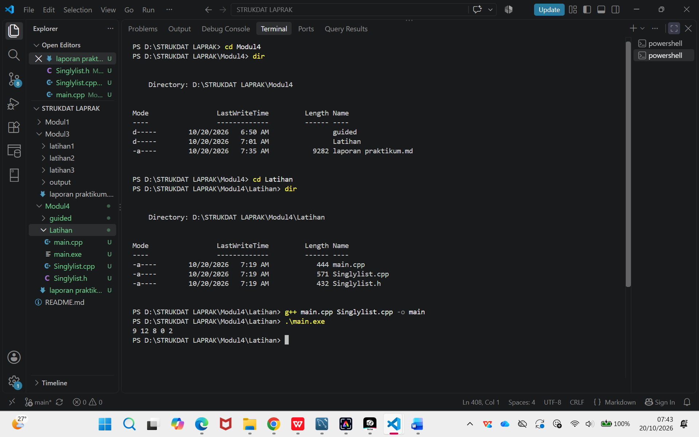

# <h1 align="center">Laporan Praktikum Modul 4 - SINGLY LINKED LIST (BAGIAN PERTAMA) </h1>

<p align="center">Nafisah Salsabila - 109082500063</p>

## Dasar Teori

### 4.1. Linked List dengan Pointer<br/>
Linked list (biasa disebut list saja) adalah salah satu bentuk struktur data (representasi penyimpanan)
berupa serangkaian elemen data yang saling berkait (berhubungan) dan bersifat fleksibel karena dapat
tumbuh dan mengerut sesuai kebutuhan. Data yang disimpan dalam Linked list bisa berupa data
tunggal atau data majemuk. Data tunggal merupakan data yang hanya terdiri dari satu data (variabel),
misalnya: nama bertipe string. Sedangkan data majemuk merupakan sekumpulan data (record) yang
di dalamnya terdiri dari berbagai tipe data, misalnya: Data Mahasiswa, terdiri dari Nama bertipe string,
NIM bertipe long integer, dan Alamat bertipe string.
Linked list dapat diimplementasikan menggunakan Array dan Pointer (Linked list).

### 4.2. Singly Linked List<br/>
Singly Linked list merupakan model ADT Linked list yang hanya memiliki satu arah pointer.

## Guided

### 1. list.cpp

```C++
source code guided 1

#include "list.h"
#include <iostream>
using namespace std;

bool isEmpty(linkedlist list)
{
    if (list.first == Nil)
    {
        return true;
    }
    else
    {
        return false;
    }
}

void createList(linkedlist &list)
{
    list.first = Nil;
}

address alokasi(string nama, string nim, int umur)
{
    address nodeBaru = new node;
    nodeBaru->isidata.nama = nama;
    nodeBaru->isidata.nim = nim;
    nodeBaru->isidata.umur = umur;
    nodeBaru->next = Nil;
    return nodeBaru;
}

void dealokasi(address &node)
{
    node->next = Nil;
    delete node;
}

void insertFirst(linkedlist &list, address nodeBaru)
{
    nodeBaru->next = list.first;
    list.first = nodeBaru;
}

void insertAfter(linkedlist &list, address nodeBaru, address prev)
{
    if (prev != Nil)
    {
        nodeBaru->next = prev->next;
        prev->next = nodeBaru;
    }
    else
    {
        cout << "Node sebelumnya tidak valid." << endl;
    }
}

void insertLast(linkedlist &list, address nodeBaru)
{
    if (isEmpty(list))
    {
        list.first = nodeBaru;
    }
    else
    {
        address nodeBantu = list.first;
        while (nodeBantu->next != Nil)
        {
            nodeBantu = nodeBantu->next;
        }
        nodeBantu->next = nodeBaru;
    }
}

void delFirst(linkedlist &list)
{
        address nodeHapus;
        if (!isEmpty(list)==false)
        {
            nodeHapus = list.first;
            list.first = list.first->next;
            nodeHapus->next = Nil;
            dealokasi(nodeHapus);
        }
        else
        {
            cout << "List kosong" << endl;
        }
}

void delLast(linkedlist &list)
{
    address nodeHapus, nodePrev;
    if (!isEmpty(list)==false)
    {
        nodeHapus = list.first;
        if (nodeHapus->next == Nil)
        {
            list.first->next = Nil;
            dealokasi(nodeHapus);
        }
        else
        {
            while (nodeHapus->next != Nil)
            {
                nodePrev = nodeHapus;
                nodeHapus = nodeHapus->next;
            }
            nodePrev->next = Nil;
            dealokasi(nodeHapus);
        }
    }
    else
    {
        cout << "List kosong" << endl;
    }
}

void delAfter(linkedlist &list, address nodeHapus, address nodePrev)
{
    if (isEmpty(list) == true)
    {
        cout << "List kosong!" << endl;
    }
    else
    {
        if (nodePrev != Nil && nodePrev->next != Nil)
        {
        nodeHapus = nodePrev->next;
        nodePrev->next = nodeHapus->next;
        nodeHapus->next = Nil;
        dealokasi(nodeHapus);
        }
        else
        {
            cout << "Node sebelumnya (prev) tidak valid!" << endl;
        }
    }
}

void printList(linkedlist list)
{
    if (isEmpty(list) == true)
    {
        cout << "List kosong!" << endl;
    }
    else
    {
        address nodeBantu = list.first;
        while (nodeBantu != Nil)
        {
            cout << "Nama: " << nodeBantu->isidata.nama << ", NIM: " << nodeBantu->isidata.nim << ", Usia: " << nodeBantu->isidata.umur << endl;
            nodeBantu = nodeBantu->next;
        }
    }
}

int nbList(linkedlist list)
{
    int count = 0;
    address nodeBantu = list.first;
    while (nodeBantu != Nil)
    {
        count++;
        nodeBantu = nodeBantu->next;
    }
    return count;
}

void deletelist(linkedlist &list)
{
    address nodeBantu, nodeHapus;
    nodeBantu = list.first;
    while (nodeBantu != Nil)
    {
        nodeHapus = nodeBantu;
        nodeBantu = nodeBantu->next;
        dealokasi(nodeHapus);
    }
    list.first = Nil;
    cout << "List sudah terhapus." << endl;
}
```

penjelasan singkat guided 1

### 2. list.h

```C++
source code guided 2

#ifndef List.h
#define List .h
#define Nil NULL
#include <iostream>
using namespace std;
struct mahasiswa
{
    string nama, nim;
    int umur;
};
typedef mahasiswa dataMahasiswa;
typedef struct node *address;
struct node
{
    dataMahasiswa isidata;
    address next;
};
struct linkedlist
{
    address first;
};

bool isEmpty(linkedlist list);
void createList(linkedlist &list);
address alokasi(string nama, string nim, int umur);
void dealokasi (address &node);
void printList(linkedlist list);
void insertFirst (linkedlist &list, address nodeBaru);
void insertAfter(linkedlist &list, address nodeBaru, address prev);
void insertLast(linkedlist &list, address nodeBaru);

void delFirst(linkedlist &list);
void delLast (linkedlist &list);
void delAfter (linkedlist &list, address nodeHapus, address nodePrev);
int nbList(linkedlist list);
void deletelist (linkedlist &list);
#endif
```

penjelasan singkat guided 2

### 3. main.cpp

```C++
source code guided 3

#include <iostream>
#include "list.h"
using namespace std;

int main()
{
    linkedlist list;
    address nodeA, nodeB, nodeC, nodeD, nodeE = Nil;
    createList(list);

    nodeA = alokasi("Dhimas", "001", 20);
    nodeB = alokasi("Budi", "002", 21);
    nodeC = alokasi("Andi", "003", 22);
    nodeD = alokasi("Caca", "004", 23);
    nodeE = alokasi("Dewi", "005", 24);
}

#endif
```

penjelasan singkat guided 3

## Unguided

### 1. Buatlah ADT Singly Linked list sebagai berikut di dalam file “Singlylist.h”:

### Singlylist.h
```cpp
source code unguided 1

#ifndef SINGLYLIST_H
#define SINGLYLIST_H

#include <iostream>
using namespace std;

#define Nil NULL

typedef int infotype;
typedef struct elmList *address;

struct elmList {
    infotype info;
    address next;
};

struct List {
    address first;
};

void createList(List &L);
address alokasi(infotype x);
void dealokasi(address &P);
void printInfo(List L);
void insertFirst(List &L, address P);

#endif
```

### Singlylist.cpp
```cpp
source code unguided 1

#include "Singlylist.h"

void createList(List &L) {
    L.first = Nil;
}

address alokasi(infotype x) {
    address P = new elmList;
    P->info = x;
    P->next = Nil;
    return P;
}

void dealokasi(address &P) {
    delete P;
    P = Nil;
}

void printInfo(List L) {
    address P = L.first;

    while (P != Nil) {
        cout << P->info;
        if (P->next != Nil) {
            cout << " ";
        }
        P = P->next;
    }
    cout << endl;
}

void insertFirst(List &L, address P) {
    P->next = L.first;
    L.first = P;
}
```

### main.cpp
```cpp
source code unguided 1

#include <iostream>
#include "Singlylist.h"
using namespace std;

int main()
{
    List L;
    address P1, P2, P3, P4, P5 = Nil;

    createList(L);

    P1 = alokasi(2);
    insertFirst(L, P1);

    P2 = alokasi(0);
    insertFirst(L, P2);

    P3 = alokasi(8);
    insertFirst(L, P3);

    P4 = alokasi(12);
    insertFirst(L, P4);

    P5 = alokasi(9);
    insertFirst(L, P5);

    printInfo(L);

    return 0;
}
```

### Output Unguided 2 :



penjelasan unguided 1 :
Program Singly Linked List terdiri dari tiga file. "Singlylist.h" berisi deklarasi tipe data dan fungsi, "Singlylist.cpp" berisi implementasi fungsi, sedangkan "main.cpp" digunakan untuk menjalankan program dengan memasukkan lima nilai. Hasil output adalah "9 12 8 0 2" karena setiap data baru ditambahkan ke bagian awal list.

## Kesimpulan
Berdasarkan praktikum yang telah dilakukan, Singly Linked List merupakan struktur data dinamis yang terdiri dari node-node yang saling terhubung melalui pointer. Implementasi dibagi menjadi tiga file, yaitu Singlylist.h sebagai deklarasi, Singlylist.cpp sebagai implementasi fungsi, dan main.cpp sebagai program pengujian. Melalui praktikum ini, dapat dipahami cara membuat list, mengalokasikan dan membebaskan memori, menambahkan elemen di awal list, serta menampilkan data. Penggunaan insertFirst menyebabkan urutan data yang ditampilkan menjadi kebalikan dari urutan pemasukan data.

## Referensi

[1] Modul pembelajaran