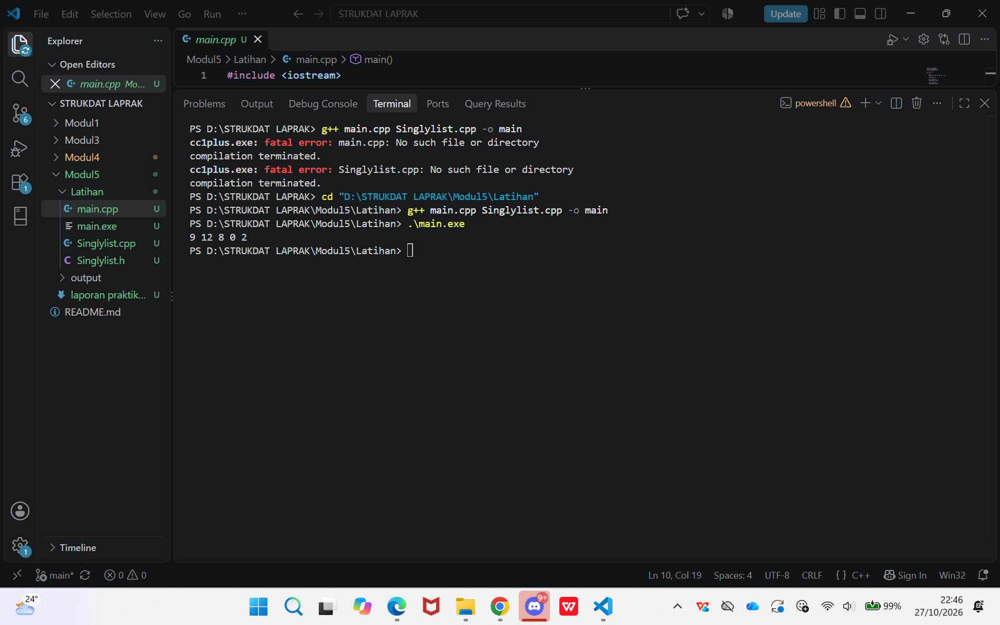

# <h1 align="center">Laporan Praktikum Modul 4 - SINGLY LINKED LIST (BAGIAN PERTAMA) </h1>

<p align="center">Nafisah Salsabila - 109082500063</p>

## Dasar Teori

### 5.1. Searching<br/>
Searching adalah operasi dasar pada list yang dilakukan untuk mencari node tertentu. Prosesnya
dilakukan dengan mengunjungi node satu per satu, dimulai dari node pertama (first), lalu berhenti
ketika node yang dicari ditemukan atau ketika seluruh node sudah dikunjungi (pointer mencapai Nil).
Hasil pencarian umumnya berupa address dari node yang ditemukan, atau Nil jika node tidak ada
dalam list. Operasi searching menjadi dasar bagi operasi lain seperti insert after, delete after,
dan update, karena operasi-operasi tersebut membutuhkan alamat node yang dituju.

### 5.2. ADT Singly Linked List<br/>
Seluruh operasi dasar pada singly linked list merupakan bagian dari ADT (Abstract Data Type)
singly linked list. Pada bahasa pemrograman C/C++, ADT disimpan dalam dua file, yaitu file header
(.h) yang berisi deklarasi tipe data dan prototype fungsi, serta file implementasi (.cpp) yang berisi
isi dari fungsi-fungsi tersebut. Pemisahan ini membuat program lebih terstruktur dan mudah
digunakan kembali.

### 5.3. Traversal pada List<br/>
Traversal adalah proses mengunjungi setiap node pada list dari node pertama sampai node terakhir
dengan menggunakan sebuah pointer bantu yang terus berpindah ke node berikutnya (`P = P->next`)
hingga bernilai Nil. Traversal digunakan pada banyak operasi, misalnya menampilkan seluruh isi
list, mencari sebuah elemen, dan menghitung total nilai info dari seluruh elemen.

## Unguided

### 1. Buatlah ADT Singly Linked list sebagai berikut di dalam file “Singlylist.h”:

### Singlylist.h
```cpp
source code unguided 1

#ifndef SINGLYLIST_H
#define SINGLYLIST_H

#include <iostream>
using namespace std;

#define Nil NULL

typedef int infotype;
typedef struct elmList *address;

struct elmList {
    infotype info;
    address next;
};

struct List {
    address first;
};

void createList(List &L);
address alokasi(infotype x);
void dealokasi(address &P);
void printInfo(List L);
void insertFirst(List &L, address P);

#endif
```

### Singlylist.cpp
```cpp
source code unguided 1
#include "Singlylist.h"

void createList(List &L) {
    L.first = Nil;
}

address alokasi(infotype x) {
    address P = new elmList;
    P->info = x;
    P->next = Nil;
    return P;
}

void dealokasi(address &P) {
    delete P;
    P = Nil;
}

void printInfo(List L) {
    address P = L.first;

    while (P != Nil) {
        cout << P->info;
        if (P->next != Nil) {
            cout << " ";
        }
        P = P->next;
    }
    cout << endl;
}

void insertFirst(List &L, address P) {
    P->next = L.first;
    L.first = P;
}
```

### main.cpp
```cpp
source code unguided 1

#include <iostream>
#include "Singlylist.h"
using namespace std;

int main()
{
    List L;
    address P1, P2, P3, P4, P5 = Nil;

    createList(L);

    P1 = alokasi(2);
    insertFirst(L, P1);

    P2 = alokasi(0);
    insertFirst(L, P2);

    P3 = alokasi(8);
    insertFirst(L, P3);

    P4 = alokasi(12);
    insertFirst(L, P4);

    P5 = alokasi(9);
    insertFirst(L, P5);

    printInfo(L);

    return 0;
}
```

### Output Unguided 1 :



penjelasan unguided 1 :
Program Singly Linked List terdiri dari tiga file. "Singlylist.h" berisi deklarasi tipe data dan fungsi, "Singlylist.cpp" berisi implementasi fungsi, sedangkan "main.cpp" digunakan untuk menjalankan program dengan memasukkan lima nilai (2, 0, 8, 12, 9). Hasil output adalah "9 12 8 0 2" karena setiap data baru ditambahkan ke bagian awal list menggunakan insertFirst, sehingga urutan tampilnya kebalikan dari urutan pemasukan.

### 2. Carilah elemen dengan info 8 dengan membuat fungsi baru.

### Singlylist.h (tambahan)
```cpp
source code unguided 2

address findElm(List L, infotype x);
```

### Singlylist.cpp (tambahan)
```cpp
source code unguided 2

address findElm(List L, infotype x) {
    address P = L.first;

    while (P != Nil) {
        if (P->info == x) {
            return P;
        }
        P = P->next;
    }
    return Nil;
}
```

### main.cpp
```cpp
source code unguided 2

#include <iostream>
#include "Singlylist.h"
using namespace std;

int main()
{
    List L;
    address P1, P2, P3, P4, P5 = Nil;

    createList(L);

    P1 = alokasi(2);
    insertFirst(L, P1);

    P2 = alokasi(0);
    insertFirst(L, P2);

    P3 = alokasi(8);
    insertFirst(L, P3);

    P4 = alokasi(12);
    insertFirst(L, P4);

    P5 = alokasi(9);
    insertFirst(L, P5);

    address cari = findElm(L, 8);
    if (cari != Nil) {
        cout << cari->info << " ditemukan dalam list" << endl;
    } else {
        cout << "8 tidak ditemukan dalam list" << endl;
    }

    return 0;
}
```

### Output Unguided 2 :


penjelasan unguided 2 :
Fungsi findElm digunakan untuk mencari elemen dengan info tertentu. Fungsi ini melakukan traversal dari node pertama (L.first) menggunakan pointer bantu P, lalu membandingkan P->info dengan nilai x pada setiap node. Jika ditemukan, fungsi langsung mengembalikan address node tersebut, dan jika sampai akhir list (Nil) tidak ditemukan, fungsi mengembalikan Nil. Pada main.cpp, hasil pencarian dicek: jika tidak Nil maka ditampilkan pesan "8 ditemukan dalam list".

### 3. Hitunglah jumlah total info seluruh elemen (9+12+8+0+2=31).

### Singlylist.h (tambahan)
```cpp
source code unguided 3

int sumInfo(List L);
```

### Singlylist.cpp (tambahan)
```cpp
source code unguided 3

int sumInfo(List L) {
    int total = 0;
    address P = L.first;

    while (P != Nil) {
        total += P->info;
        P = P->next;
    }
    return total;
}
```

### main.cpp
```cpp
source code unguided 3

#include <iostream>
#include "Singlylist.h"
using namespace std;

int main()
{
    List L;
    address P1, P2, P3, P4, P5 = Nil;

    createList(L);

    P1 = alokasi(2);
    insertFirst(L, P1);

    P2 = alokasi(0);
    insertFirst(L, P2);

    P3 = alokasi(8);
    insertFirst(L, P3);

    P4 = alokasi(12);
    insertFirst(L, P4);

    P5 = alokasi(9);
    insertFirst(L, P5);

    cout << "Total info dari kelima elemen adalah " << sumInfo(L) << endl;

    return 0;
}
```

### Output Unguided 3 :


penjelasan unguided 3 :
Fungsi sumInfo menghitung total nilai info dari seluruh elemen list. Variabel total diinisialisasi dengan 0, kemudian dilakukan traversal dari node pertama sampai Nil, dan pada setiap node nilai P->info ditambahkan ke total. Dengan data 9, 12, 8, 0, dan 2, hasil penjumlahannya adalah 31.

## Kesimpulan
Berdasarkan praktikum yang telah dilakukan, operasi searching pada Singly Linked List dilakukan dengan menelusuri node satu per satu (traversal) dari node pertama hingga node yang dicari ditemukan atau list berakhir. Fungsi findElm mengembalikan address node jika ditemukan dan Nil jika tidak, sedangkan traversal yang sama dapat dimanfaatkan untuk menghitung total info seluruh elemen melalui fungsi sumInfo. Pemisahan program ke dalam file Singlylist.h, Singlylist.cpp, dan main.cpp membuat ADT lebih terstruktur dan mudah dikembangkan dengan menambahkan fungsi baru.

## Referensi

[1] Modul pembelajaran