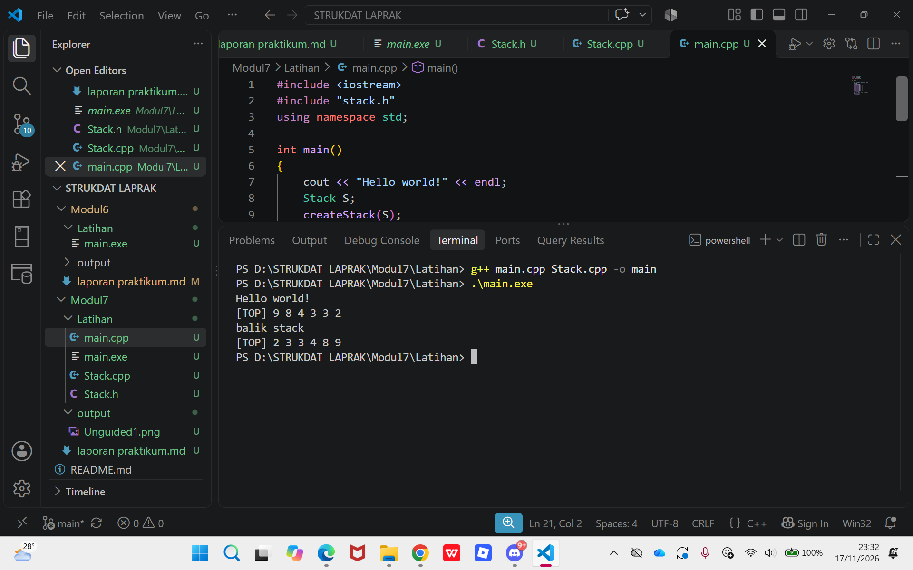
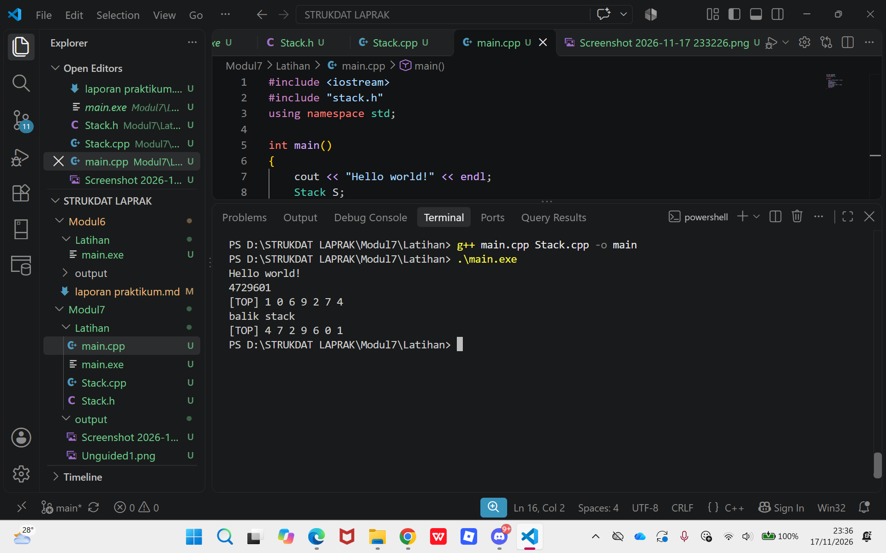

# <h1 align="center">Laporan Praktikum Modul 7 - STACK </h1>

<p align="center">Nafisah Salsabila - 109082500063</p>

## Dasar Teori

### 7.1. Stack<br/> 
Stack adalah salah satu bentuk struktur data yang prinsip kerjanya seperti tumpukan. Elemen yang bisa diambil terlebih dahulu adalah elemen yang paling atas, yaitu elemen yang terakhir kali dimasukkan. Prinsip ini disebut LIFO (Last In First Out). Pada stack, akses data hanya dilakukan pada satu sisi saja, yaitu bagian atas (Top).
### 7.2. Komponen Stack<br/>
Komponen stack pada dasarnya sama dengan singly linked list, hanya saja akses elemen hanya bisa dilakukan di awal stack. Komponen utamanya adalah:
Top: penunjuk elemen paling atas pada stack, dan merupakan satu-satunya komponen yang dipakai untuk mengakses data. Info: data yang disimpan pada setiap elemen stack. Next: pointer pada elemen yang menunjuk ke elemen di bawahnya (pada representasi pointer). Stack dikatakan kosong jika Top = Nil (representasi pointer) atau Top = 0 / -1 (representasi tabel).

### 7.3. Operasi Dasar Stack<br/>
Push: operasi menyisipkan elemen ke bagian atas stack, sama seperti insert first pada list. Pada representasi pointer: P = alokasi(X), P->next = S.Top, lalu S.Top = P. Pada representasi tabel: Top = Top + 1, lalu info[Top] = X. Pop: operasi mengambil elemen paling atas stack, sama seperti delete first pada list. Pada representasi pointer: P = S.Top, lalu S.Top = (S.Top)->next. Pada representasi tabel: X = info[Top], lalu Top = Top - 1.

### 7.4. Primitif Stack<br/>
Primitif dalam stack lebih sedikit dibanding list lainnya karena operasi hanya dilakukan pada elemen paling atas, antara lain createStack(), isEmpty(), isFull() (khusus tabel), alokasi() dan dealokasi() (khusus pointer), printInfo(), serta fungsi pencarian dan primitif lainnya.

### 7.5. Representasi Stack<br/>
Stack dapat direpresentasikan dengan pointer maupun tabel (array). Representasi pointer bersifat dinamis sehingga jumlah elemen tidak dibatasi dan memerlukan manajemen memori (alokasi dan dealokasi). Representasi tabel menggunakan array berindeks sehingga jumlah elemennya terbatas (Imax) dan tidak memerlukan manajemen memori. Pada praktikum ini stack dibuat dengan representasi tabel (array) berukuran 20 elemen.

## Unguided

### 1. Buatlah ADT Stack menggunakan ARRAY sebagai berikut di dalam file “stack.h”:

### Stack.h
```cpp
source code unguided 1
#ifndef STACK_H
#define STACK_H

#include <iostream>
using namespace std;

#define MAXSTACK 20

typedef int infotype;

struct Stack {
    infotype info[MAXSTACK];
    int top;
};

void createStack(Stack &S);
bool isEmpty(Stack S);
bool isFull(Stack S);
void push(Stack &S, infotype x);
infotype pop(Stack &S);
void printInfo(Stack S);
void balikStack(Stack &S);

#endif
```

### Stack.cpp
```cpp
source code unguided 1
#include "stack.h"

void createStack(Stack &S) {
    S.top = -1;
}

bool isEmpty(Stack S) {
    return S.top == -1;
}

bool isFull(Stack S) {
    return S.top == MAXSTACK - 1;
}

void push(Stack &S, infotype x) {
    if (!isFull(S)) {
        S.top++;
        S.info[S.top] = x;
    } else {
        cout << "stack penuh" << endl;
    }
}

infotype pop(Stack &S) {
    infotype x = -1;
    if (!isEmpty(S)) {
        x = S.info[S.top];
        S.top--;
    } else {
        cout << "stack kosong" << endl;
    }
    return x;
}

void printInfo(Stack S) {
    cout << "[TOP] ";
    for (int i = S.top; i >= 0; i--) {
        cout << S.info[i] << " ";
    }
    cout << endl;
}

void balikStack(Stack &S) {
    int i = 0;
    int j = S.top;
    while (i < j) {
        infotype temp = S.info[i];
        S.info[i] = S.info[j];
        S.info[j] = temp;
        i++;
        j--;
    }
}
```

### main.cpp
```cpp
source code unguided 1
#include <iostream>
#include "stack.h"
using namespace std;

int main()
{
    cout << "Hello world!" << endl;
    Stack S;
    createStack(S);
    push(S, 3);
    push(S, 4);
    push(S, 8);
    pop(S);
    push(S, 2);
    push(S, 3);
    pop(S);
    push(S, 9);
    printInfo(S);
    cout << "balik stack" << endl;
    balikStack(S);
    printInfo(S);
    return 0;
}
```

### Output Unguided 1 :


penjelasan unguided 1 :
ADT Stack dibuat dengan representasi array dalam tiga file. "stack.h" berisi deklarasi tipe infotype (integer), struct Stack (array info berukuran 20 dan top), serta prototype fungsi. "stack.cpp" berisi implementasi fungsi. createStack mengisi top dengan -1 sebagai tanda stack kosong. push menaikkan top lalu mengisi info[top] dengan nilai baru, sedangkan pop mengambil info[top] lalu menurunkan top. Sebelum push dan pop dilakukan pengecekan isFull dan isEmpty agar tidak terjadi overflow maupun underflow.

### 2. Tambahkan prosedur pushAscending( in/out S : Stack, in x : integer)

### Stack.h (tambahan)
```cpp
source code unguided 2
void pushAscending(Stack &S, infotype x);
```

### Stack.cpp (tambahan)
```cpp
source code unguided 2
void pushAscending(Stack &S, infotype x) {
    Stack T;
    createStack(T);

    while (!isEmpty(S) && S.info[S.top] > x) {
        push(T, pop(S));
    }

    push(S, x);

    while (!isEmpty(T)) {
        push(S, pop(T));
    }
}
```

### main.cpp
```cpp
source code unguided 2
#include <iostream>
#include "stack.h"
using namespace std;

int main()
{
    cout << "Hello world!" << endl;
    Stack S;
    createStack(S);
    pushAscending(S, 3);
    pushAscending(S, 4);
    pushAscending(S, 8);
    pushAscending(S, 2);
    pushAscending(S, 3);
    pushAscending(S, 9);
    printInfo(S);
    cout << "balik stack" << endl;
    balikStack(S);
    printInfo(S);
    return 0;
}
```

### Output Unguided 2 :



penjelasan unguided 2 :
Prosedur pushAscending memasukkan elemen ke stack sambil menjaga agar isi stack tetap terurut, yaitu elemen terbesar berada di top dan elemen terkecil di dasar stack. Karena stack hanya bisa diakses dari atas, digunakan sebuah stack bantu T. Elemen-elemen di top S yang nilainya lebih besar dari x dipindahkan dulu ke T menggunakan pop dan push, kemudian x di-push ke S, lalu semua elemen di T dikembalikan ke S.

### 3. Tambahkan prosedur getInputStream( in/out S : Stack ). Prosedur akan terus membaca dan menerima input user dan memasukkan setiap input ke dalam stack hingga user menekan tombol enter. Contoh: gunakan cin.get() untuk mendapatkan inputan user.

### Stack.h (tambahan)
```cpp
source code unguided 3
void getInputStream(Stack &S);
```

### Stack.cpp (tambahan)
```cpp
source code unguided 3
void getInputStream(Stack &S) {
    char c;
    cin.get(c);
    while (c != '\n' && !isFull(S)) {
        if (c >= '0' && c <= '9') {
            push(S, c - '0');
        }
        cin.get(c);
    }
}
```

### main.cpp
```cpp
source code unguided 3
#include <iostream>
#include "stack.h"
using namespace std;

int main()
{
    cout << "Hello world!" << endl;
    Stack S;
    createStack(S);
    getInputStream(S);
    printInfo(S);
    cout << "balik stack" << endl;
    balikStack(S);
    printInfo(S);
    return 0;
}
```

### Output Unguided 3 :



penjelasan unguided 3 :
Prosedur getInputStream membaca input dari user satu karakter demi satu karakter menggunakan cin.get() dan terus berulang sampai user menekan enter (karakter '\n') atau stack sudah penuh. Setiap karakter angka diubah menjadi nilai integer dengan c - '0', lalu dimasukkan ke stack dengan push.

## Kesimpulan
Berdasarkan praktikum yang telah dilakukan, Stack merupakan struktur data yang menerapkan prinsip LIFO (Last In First Out), di mana penambahan dan pengambilan elemen hanya dilakukan pada satu sisi, yaitu top. Stack dengan representasi array berhasil diimplementasikan pada ADT yang dibagi menjadi stack.h, stack.cpp, dan main.cpp, dengan operasi dasar push dan pop serta operasi tambahan printInfo, balikStack, pushAscending, dan getInputStream. Pada representasi array, ukuran stack terbatas sehingga perlu dilakukan pengecekan isFull sebelum push dan isEmpty sebelum pop. Selain itu, karena akses hanya dari top, operasi seperti pushAscending memerlukan stack bantu untuk menyisipkan elemen pada posisi yang tepat.

## Referensi

[1] Modul pembelajaran